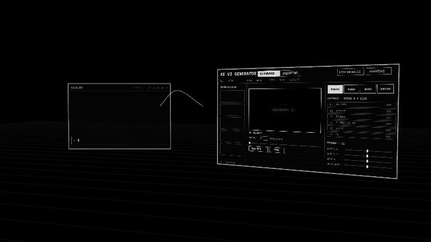
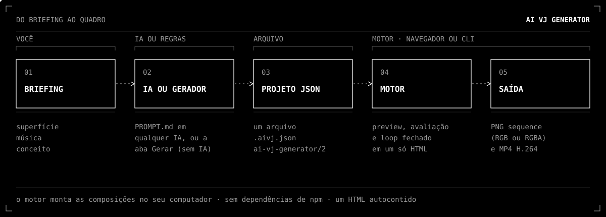
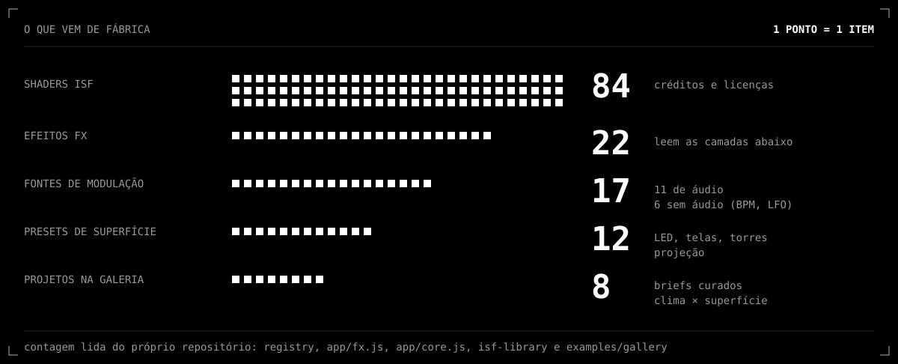
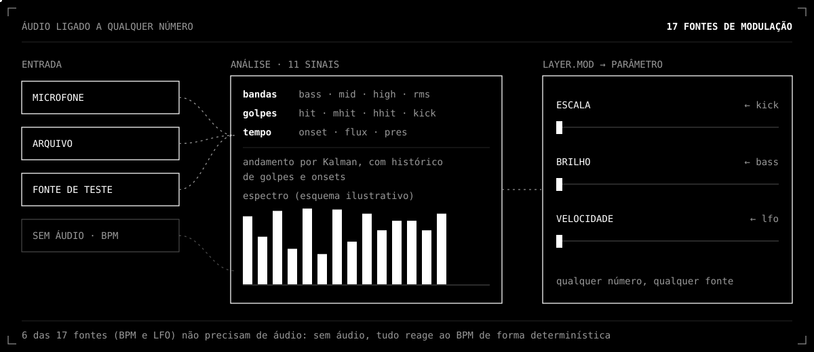
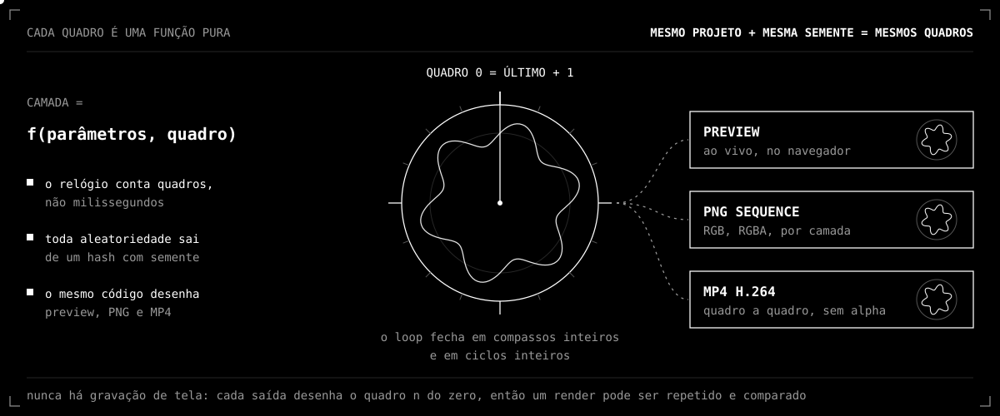

<p align="center">
  
</p>

<h1 align="center">AI VJ Generator</h1>

<p align="center"><sub>DO <code>/VJ</code> AO MOTOR GRÁFICO · A MESMA ANIMAÇÃO DA CAPA EM <a href="https://gyulyia.com/tools/vj-generator.html">GYULYIA.COM/TOOLS</a></sub></p>

**Sistema generativo de animação orientado por direção de arte, com instruções que qualquer IA entende (ou nenhuma).** Você descreve a peça (superfície, música, conceito) para uma IA, preenche um briefing no navegador, ou usa o gerador sem IA. O resultado é **um arquivo JSON** que o motor abre, mostra em preview e exporta em **PNG sequence (RGB ou RGBA, projeto completo, por região ou por camada) e MP4 (H.264, sem alpha)**. Mesmo projeto + mesma semente = mesmos quadros, e todo loop fecha.

*Generative animation system driven by art direction, with instructions any AI can follow (or none at all). Describe the surface, the music and the concept to an AI, fill a brief in the browser, or use the AI-free generator; get one JSON file the engine opens, previews and exports as PNG sequences (RGB or RGBA, full project, region or layer) and MP4. English summary at the end.*

**Demonstração online:** <https://gyulyia3d-cloud.github.io/ai-vj-generator/> · **Documentação:** [docs/README.md](docs/README.md) · **Começo rápido:** [docs/QUICKSTART.md](docs/QUICKSTART.md) · **O que falta:** [docs/PROXIMOS-PASSOS.md](docs/PROXIMOS-PASSOS.md)

## Do briefing ao quadro



Você descreve a peça, a IA (ou o gerador por regras) escreve **um** arquivo JSON, e é o motor que desenha, mede e exporta. Trocar de IA não muda o resultado do motor: o contrato é o arquivo.

## Comece em 1 minuto (sem instalar nada)

1. Baixe o repositório (**Code → Download ZIP**) e descompacte.
2. Dê dois cliques em `app/index.html` (Chrome ou Edge).
3. Sem IA e sem Python: clique em **Gerar briefing**, responda a auditoria, junte as mídias e descreva o projeto; o motor monta as composições no seu computador. Ou, com Python: gere o projeto a partir de um briefing JSON com `python skill/ai-vj-generator/scripts/brief_to_project.py brief.json --out projeto.aivj.json` (exemplo de briefing em `examples/briefs/`), depois **Carregar** o JSON no motor. Depois escolha o preset da sua superfície na aba Superfície.
4. Ajuste, avalie, exporte na aba **Exportar** (PNG sequence ou MP4).

Passo a passo ilustrado em texto: [docs/GUIA-SEM-IA.md](docs/GUIA-SEM-IA.md). Para microfone e janela de saída o navegador exige `http://`: `node scripts/serve.mjs` e abra `http://localhost:5173`.

## Instalação no Claude



O motor não depende de uma IA específica; o Claude entra de três formas, da mais completa à mais simples:

| Onde você usa o Claude | O que fazer | O que você ganha |
|---|---|---|
| **Claude Code, com os comandos `/vj`** | instalar o adaptador (passo a passo abaixo) | a skill `ai-vj-generator` e os comandos `/vj`, `/vj-reference`, `/vj-critique` e `/how-to-use`; com acesso a arquivos e terminal, a IA roda validador, folha de contato e render e corrige o que achar |
| **Claude Code, sem instalar nada** | abrir a pasta do repositório no Claude Code | o `CLAUDE.md` da raiz aponta para o `portable/PROMPT.md`; mesmo método, sem os comandos `/vj` |
| **Claude no chat** (claude.ai, apps) | colar [`skill/ai-vj-generator/portable/PROMPT.md`](skill/ai-vj-generator/portable/PROMPT.md) como primeira mensagem; anexar `schema/project.schema.json` e `references/project-schema.md` se o chat aceitar arquivos | a IA conduz o briefing e escreve o JSON; sem terminal ela não renderiza e deve dizer isso, então você abre o JSON no motor e confere |

### Passo a passo no Claude Code

**1. Pré-requisitos.** [Git](https://git-scm.com) e [Claude Code](https://claude.com/claude-code). Python 3 e Node.js 22 ou mais novo ajudam (validador e renderização). Imagem e vídeo anexados pedem `pip install pillow numpy` e, para vídeo, `ffmpeg`.

**2. Instalar.** Rode de dentro do repositório (o instalador acha `skill/ai-vj-generator` pela raiz).

```bash
# macOS / Linux
git clone https://github.com/gyulyia3d-cloud/ai-vj-generator.git && cd ai-vj-generator && sh adapters/claude/install.sh
```

```powershell
# Windows (PowerShell)
git clone https://github.com/gyulyia3d-cloud/ai-vj-generator.git; cd ai-vj-generator; powershell -ExecutionPolicy Bypass -File adapters\claude\install.ps1
```

O instalador copia as pastas para `~/.claude/skills/` (ou para `$CLAUDE_SKILLS_DIR`, se definida).

**3. Reiniciar o Claude Code e digitar** `/vj` seguido do briefing: o que você cria, onde será exibido, como deve soar.

```text
/vj Set de techno industrial: LED 5120×500 em duas paredes em L, 132 BPM, preciso de PNG sequence com alpha. Anexei um print e um vídeo de referência.
```

**4. Abrir o resultado.** A IA entrega um projeto `*.aivj.json`. Abra `app/index.html` (Chrome ou Edge), carregue o JSON e exporte na aba **Exportar**.

| Comando | O que faz |
|---|---|
| `/vj <briefing>` | começa um projeto novo do zero; projetos, exemplos, presets e paletas anteriores não entram nessa rodada |
| `/vj-reference` | analisa imagens e vídeos anexados como referência e devolve uma gramática de referência, sem construir nada |
| `/vj-critique <projeto>` | revisa um projeto pronto contra o briefing, o contrato criativo e os critérios de qualidade, e propõe mutações em ordem |
| `/how-to-use` | explica tudo o que a ferramenta faz dentro do chat, em português ou inglês; roda sozinho uma vez no primeiro uso |

**Atualizar:** `git pull` e rode o instalador de novo (ele substitui as pastas instaladas).

**Se algo não aparece**
- `/vj` não existe: reinicie o Claude Code e confira se `~/.claude/skills/vj/SKILL.md` existe.
- "Skill não encontrada": o instalador precisa rodar de dentro do repositório.
- Sem Claude Code: ignore esta seção; nada do motor depende dela. Detalhes: [adapters/claude/INSTALL.md](adapters/claude/INSTALL.md).

## Use com a IA que você já tem

O núcleo é **um texto**: [`skill/ai-vj-generator/portable/PROMPT.md`](skill/ai-vj-generator/portable/PROMPT.md). Cole como primeira mensagem (ChatGPT, Gemini, Claude, um modelo local) ou aponte a ferramenta para o `AGENTS.md` (Codex, Cursor e outros), `GEMINI.md` ou `CLAUDE.md` da raiz, que apontam para ele. A IA conduz o briefing, escreve o projeto JSON, e você o abre no motor. Detalhes por ferramenta: [adapters/README.md](adapters/README.md) e [docs/AI-AGNOSTIC.md](docs/AI-AGNOSTIC.md). Quem usa o Claude Code pode instalar a skill com comandos `/vj`: [adapters/claude/INSTALL.md](adapters/claude/INSTALL.md).

## O que o motor sabe fazer





| | |
|---|---|
| **Camadas** | 10 categorias (Fundo, Shader, Formas, Elementos 3D, Texto, Mídia, Dados, Partículas, Efeito, Código); o tipo dentro da categoria se escolhe nos parâmetros da camada (shader GLSL, biblioteca ISF, cadeia `synth`, formas, linhas, tipografia, imagem, vídeo, objeto 3D, parallax, partículas, filtros `fx`, manchas…). |
| **`fx`: efeitos sobre a pilha** | 22 efeitos que leem as camadas abaixo: CRT, VHS, halftone, hachura, dither, bordas, Kuwahara, painel de LED, vidro líquido, bloom, aberração, espelho, polar, glitch… |
| **`blobs`** | acha regiões da imagem abaixo (brilho, contraste, cor, zona) e as marca com caixas, números e ligações. |
| **ISF** | camada do tipo ISF com 84 geradores (11 originais, MIT e CC0 com autoria) escolhidos nos parâmetros da camada. |
| **Áudio** | microfone, arquivo ou fonte de teste; bandas, golpes, kick e onset com histórico, andamento por Kalman; `layer.mod` liga qualquer número a qualquer fonte. Sem áudio, tudo reage ao BPM de forma determinística. |
| **Movimento** | perfis de mola, 13 formas de LFO, 16 transições, easings Penner. |
| **Superfície** | 12 presets de LED, telas e torres, dobras, regiões importadas de CSV/PNG (só entrada), avisos de legibilidade; render do projeto completo ou de uma região. |
| **Saída** | PNG sequence (alpha, RGB, branco-α, por camada, ZIP em partes, manifesto SHA-256), **MP4 H.264 quadro a quadro** (aba ou `node scripts/render.mjs`), segurança de flash (WCAG 2.3.1) com limitador. |
| **Qualidade** | validador, avaliador estrutural com nota, folha de contato, teste de loop, censo de sementes, dezenas de áreas de teste em `node scripts/check.mjs`. |

### Áudio ligado a qualquer número



## Princípio de engenharia



Cada camada é uma **função pura de (parâmetros, número do quadro)**: o relógio conta quadros, não milissegundos, e toda aleatoriedade sai de um hash com semente. Por isso o mesmo código desenha o preview, o PNG e o MP4, o último quadro encaixa no primeiro, e um render pode ser repetido e comparado. Nunca há gravação de tela.

## O que o produto faz e não faz

| Capacidade | Estado |
|---|---|
| Geração, composição, animação, análise de superfície e de áudio, preview (inclui tela cheia) | Suportado |
| PNG sequence (RGB, RGBA, por camada, por região), MP4 (sem alpha), JSON, manifesto | Exportável |
| Blueprint, planta, pixel map, foto da superfície, máscara, referência | Só entrada e análise: o motor lê, nunca gera |
| MIDI, OSC, NDI, Spout, Syphon, SDI, integração com Resolume, TouchDesigner ou OBS, mapping, simulação da instalação | Fora de escopo |

Roadmap em vigor: [docs/ROADMAP.md](docs/ROADMAP.md). Os arquivos exportados são arquivos comuns; qualquer software os abre.

## Estrutura do repositório

```text
app/                    motor: index.html (um arquivo) + módulos (fx, synth, blobs, isf-ui, mp4, …)
skill/ai-vj-generator/  conteúdo para qualquer IA: portable/PROMPT.md, SKILL.md (roteador), references/,
                        scripts/ (validador, geradores, testes), schema/, isf-library/, assets/engine.html
adapters/               como cada ferramenta carrega as instruções (README.md); claude/ tem o instalador
examples/               briefs, galeria de 8 projetos e 24 composições com notas
scripts/                serve · build · render · bench · check · embed-* · sync-skill
docs/                   guias e roadmap
AGENTS.md · GEMINI.md · CLAUDE.md   ponteiros para o PROMPT.md, na raiz para as ferramentas acharem
```

## Desenvolvimento

```bash
node scripts/serve.mjs                               # http://localhost:5173
node scripts/embed-modules.mjs && node scripts/build.mjs && node scripts/sync-skill.mjs   # depois de editar app/
node scripts/check.mjs                               # tudo; precisa terminar em "Tudo certo."
node scripts/render.mjs projeto.aivj.json --out saida --format mp4
node scripts/bench.mjs projeto.aivj.json             # custo por camada
node scripts/readme-assets.mjs                       # regera os infográficos do README (docs/assets/*.svg)
```
Sem dependências de npm; a única biblioteca de terceiros é o JSZip 3.10.1 (MIT ou GPLv3), embutida em `app/vendor/` (sem CDN: o export em ZIP funciona sem rede); só as fontes web vêm de fora e têm fallback do sistema. Regras do repositório: [AGENTS.md](AGENTS.md) e [CONTRIBUTING.md](CONTRIBUTING.md). Histórico: [CHANGELOG.md](CHANGELOG.md).

## English summary

AI VJ Generator is an open-source, single-file browser engine for generative animation plus a plain-text instruction pack that any AI can follow (`skill/ai-vj-generator/portable/PROMPT.md`; or no AI at all through the in-browser **Gerar** tab). It produces one JSON project and renders deterministic loops: alpha PNG sequences and MP4 (H.264, frame by frame, no screen capture), for the full project or one region. Layers include GLSL fields, one-line `synth` chains, stack-reading `fx` effects and `blobs` detection, an 84-shader ISF library with credits and licences, audio-reactive modulation, surface presets and imported regions, and flash-safety tools. It is not a performance tool, media server or mapping tool. Start by opening `app/index.html`; see `docs/QUICKSTART.md`.

## Créditos

Criado por **GYULYIA** (Giulia Ribeiro), artista de visuais em tempo real, São Paulo. Design system GYULYIA (monocromático, Martian Mono). A linguagem do modo STANDARD estuda o Graphic Realism; glifos, códigos e pictogramas são originais. Shaders ISF de terceiros mantêm autoria e licença (`skill/ai-vj-generator/isf-library/README.md`). A animação de abertura é a capa do VJ Generator em [gyulyia.com/tools](https://gyulyia.com/tools/vj-generator.html), capturada quadro a quadro (`docs/assets/vj-generator-thumbnail.gif`). A fonte Martian Mono embutida nos infográficos é SIL OFL 1.1 (subset latino em `docs/assets/fonts/`).

[gyulyia.com](https://gyulyia.com) · [@gyulyia](https://instagram.com/gyulyia) · Licença [MIT](LICENSE)
